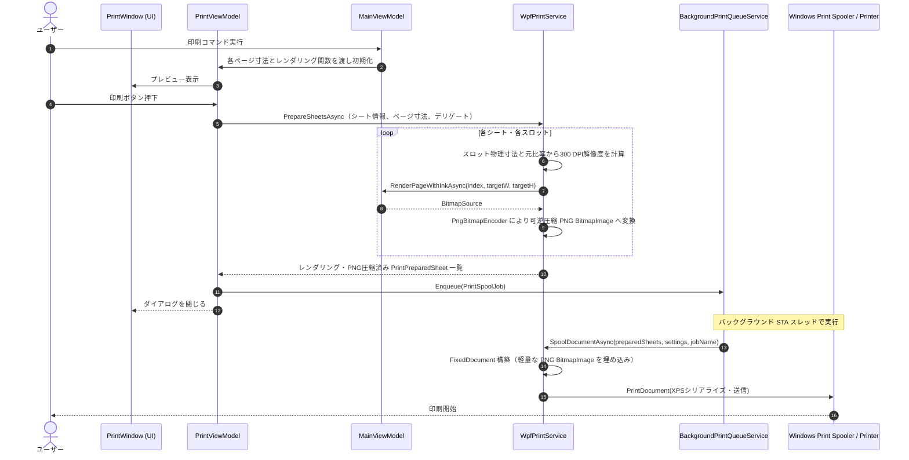

# Issue #206 印刷品質の向上および送信高速化 実装計画

## 1. 概要・背景
Issue #206 では、印刷機能に関して以下の課題が提示されている:
1. **印刷処理の細かい流れの確認・整理**
2. **印刷側に渡す解像度の向上・最適化の検討**
3. **印刷実行後、プリンターへの送信に他アプリより大幅に時間がかかっている原因の調査と改善**

### 調査結果と原因分析
- **解像度の課題**:
  現在、`MainViewModel.cs` から `PrintViewModel` に渡される印刷レンダリングデリゲートは `(idx, ct) => RenderPageWithInkAsync(idx, 2480, 3508, ct)` となっており、用紙サイズ（A3/A4）、向き（縦/横）、面付け（N-Up/冊子）、元PDFページのアスペクト比に関わらず一律で A4縦（2480×3508）に固定されていた。そのため、A3印刷時に解像度不足（約212 DPIに低下）が生じたり、横長ページや特殊サイズページで比率不整合が発生していた。
- **プリンター送信遅延の課題**:
  ダイアログが閉じた後のスプール処理（`WpfPrintService.ExecutePrintSpool`）において、300 DPIの非圧縮生ピクセルビットマップ（32bpp、1ページ約35MB）がそのまま WPF の `FixedPage` 上の `Image` コントロールに渡されていた。WPF の XPS シリアライザおよび Windows プリンタスプーラ（`printfilterpipelinesvc.exe`）が数十〜数百MBの巨大な非圧縮データを処理・展開するため、プリンターへの送信に他アプリより大幅に時間がかかっていた。

---

## 2. 印刷処理の全体フロー（アーキテクチャ）

---

## 3. 実装方針・変更仕様

### 3.1 300 DPI 基準の動的解像度計算
- 用紙サイズ（A4: 210×297mm, A3: 297×420mm）および印刷の向きから、用紙全体の物理ピクセル数（300 DPI基準）を算出:
  - A4 縦: 2480 × 3508 px / A4 横: 3508 × 2480 px
  - A3 縦: 3508 × 4960 px / A3 横: 4960 × 3508 px
- 各シート上の placement（スロット）の `NormalizedBounds`（幅比率・高さ比率）からスロット最大ピクセル数（`slotW, slotH`）を算出。
- 該当ページの元寸法（`pageWidth, pageHeight`）のアスペクト比を維持しつつ、スロット内に内接（Fit）する最適なレンダリングピクセル寸法（`renderWidth, renderHeight`）を計算。
- これにより、A3印刷時は 3508×4960 を基準とした高解像度レンダリングが行われ、N-Up（2-Up, 4-Up）時はスロットサイズに応じた適切な解像度でレンダリングされ、無駄なオーバーサンプリングやボケを防止する。

### 3.2 PNG 可逆圧縮によるスプール軽量化と送信高速化
- `PrepareSheetsAsync` の各ページレンダリング直後に、得られた `BitmapSource` を `PngBitmapEncoder` を用いてインメモリで可逆圧縮 PNG ストリーム（`BitmapImage`）へ変換して保持する。
- **効果**:
  1. メモリ消費の削減: 1ページあたり約35MBの生ビットマップが、PNG圧縮により数MB程度に圧縮（約80〜90%削減）。
  2. スプール生成の高速化: WPF の XPS ドキュメントライターは、入力が `BitmapImage`（PNGストリーム）の場合に再エンコードをバイパスして直接パッケージに格納できるため、XPS シリアライズが高速化。
  3. 送信速度の大幅短縮: Windows プリンタスプーラに送られるスプールデータ量が激減し、プリンターへのジョブ転送・印刷開始までの時間が他アプリ同等水準に短縮される。

### 3.3 インターフェースおよびクラスの変更
- `IPrintService.cs`:
  - `PrepareSheetsAsync` の引数またはオーバーロードを調整。
  - レンダリング関数を `Func<int, int, int, CancellationToken, Task<BitmapSource?>>`（引数: `pageIndex, width, height, cancellationToken`）とし、各ページの元の幅・高さを参照できる情報（`IReadOnlyList<(double width, double height)>` または `Func<int, (double width, double height)>`）を受け取る形にする。
- `WpfPrintService.cs`:
  - 解像度計算ヘルパーメソッド（`CalculateTargetResolution`）の追加。
  - `PngBitmapEncoder` を用いたインメモリPNGエンコード処理の実装。
- `PrintViewModel.cs`:
  - `_renderPrintPageFunc` デリゲートのシグネチャを幅・高さ指定対応に変更。
  - ページ寸法リストを保持・受け渡し。
- `MainViewModel.cs`:
  - `PrintViewModel` 生成時に各ページの元寸法コレクション（`Document.Pages.Select(p => (p.DisplayWidth, p.DisplayHeight)).ToList()`）と `RenderPageWithInkAsync` を渡す。

---

## 4. 単体テスト計画
1. **解像度計算ロジックの単体テスト**:
   - A4 縦・横、A3 縦・横における 1-Up（全面）のスロット解像度計算
   - N-Up（2-Up, 4-Up）時のスロット解像度計算
   - 縦長PDF、横長PDFそれぞれのアスペクト比維持と内接寸法の検証
2. **PNG変換・スプール準備の単体テスト**:
   - `PrepareSheetsAsync` によるレンダリング画像の生成とPNG形式保持の検証
3. **`PrintViewModel` 連携テスト**:
   - 各パラメータが正しく `IPrintService` に渡され、進捗報告とスプールイベントが正常に発火することの検証

---

## 5. ドキュメント更新
- `docs/basic_design.md`: 印刷機能のアーキテクチャ、解像度計算仕様、PNGスプール最適化の設計を追記。
- `docs/plans/issue-206-improve-print-quality-plan.md`: 本計画の保存。
