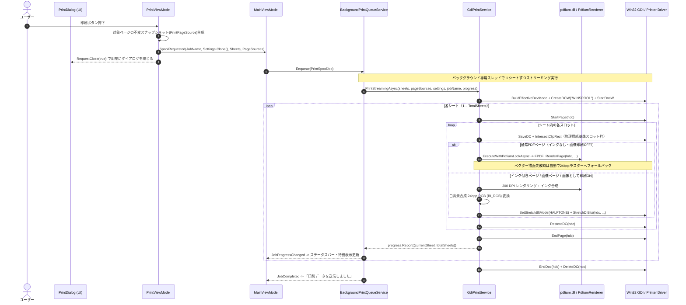

# Issue #249 印刷の大幅高速化（Win32 GDI + PDFium ハイブリッド印刷）実装計画

## 1. 概要・背景と原因分析

### 課題
印刷プレビューで印刷ボタンを押した後、プレビュー画面は即座に閉じるものの、ステータスバーに「プリンターへ送信中...」が表示されたままプリンターへの送信完了までに Word や他社 PDF エディターと比べて倍以上の時間がかかっている。

### 原因分析
1. **WPF（XPS）経由の全ページ 300 DPI 画像印刷**:
   現在の `WpfPrintService` は、文字中心のページを含め全ページを 300 DPI のラスター画像に変換し、WPF `FixedDocument` / `PrintDialog.PrintDocument`（XPS 形式）で送信している。Windows の一般的なプリンタードライバーは XPS を受け取ると内部の XPS → GDI/PDL 変換パイプライン（`PrintFilterPipelineSvc`）を通過するため、変換・転送・プリンター側展開（RIP）のすべてで大幅な遅延が発生する。
2. **透過付き `Bgra32` と実質的な二重エンコード**:
   `ConvertToCompressedPngBitmap` で `BitmapCacheOption.OnLoad` 指定後に `MemoryStream` を破棄しているため、メモリ上にはデコード済み非圧縮ビットマップが残り、後段の XPS シリアライズ時に CPU シングルスレッドでの再エンコードが発生している。さらにアルファチャンネル付き（`Bgra32`）のため、ドライバーが透過合成と判断して 600 DPI 以上でページ全体を再ラスタライズしやすい。
3. **全ページ一括構築の同期スプール**:
   全シートの `FixedPage`（レイアウト計算含む）を先にメモリ上へ一括構築してから `PrintDocument` を同期実行しているため、1 ページ目の出力開始が遅くメモリ負荷も高い。
4. **印刷ごとの `PrintQueue` / `PrintTicket` 問い合わせオーバーヘッド**:
   印刷のたびに `LocalPrintServer`・`PrintQueue`・`PrintTicket`（および `DEVMODE` 変換）を同期取得している。

---

## 2. 全体アーキテクチャ

WPF/XPS 印刷パイプラインを廃止し、**Win32 GDI + PDFium 直接ベクター印刷（標準）** と **Win32 GDI 直接 24bpp ラスター印刷（互換・インク付きページ）** のハイブリッド構成へ刷新する。また、印刷ボタン押下後は即座にプレビューを閉じ、バックグラウンドで **1 シートずつストリーミング送信** を行う。



---

## 3. 変更・新規作成対象ファイルと詳細設計

### 3.1 Core モデル (`src/PDFBinder.Core/Models/`)

#### `PrintSettings.cs`（変更）
- `[ObservableProperty] private bool _printAsImage;` を追加（初期値 `false`）。
- `ResetToDefault()`、`CopyFrom(PrintSettings source)`、`Clone()` に `PrintAsImage` の初期化・複製処理を追加する。

#### `PrintPageSource.cs`（新規作成）
- 印刷実行時点のページ状態をバックグラウンドスレッドへ安全に渡すための不変スナップショットレコード／クラスを定義する。
- 保持項目:
  - `SourceFilePath` (`string?`)
  - `OriginalPageIndex` (`int`)
  - `SourcePassword` (`string?`)
  - `DisplayWidth` (`double`)
  - `DisplayHeight` (`double`)
  - `RenderRotation` (`PageRotation`)
  - `IsBlankPage` (`bool`)
  - `IsImage` (`bool`)
  - `HasSourceBinderInkAnnotation` (`bool`)
  - `InkStrokes` (`StrokeCollection`: スナップショット作成時に `Clone()` して UI 側の後続編集から隔離)
- 判定プロパティ `HasInk => InkStrokes.Count > 0` を提供する。

### 3.2 Core サービス (`src/PDFBinder.Core/Services/`)

#### `IPdfRenderer.cs` & `PdfiumRenderer.cs`（変更）
- **PDFium ロック共有メソッドの追加**:
  - `Task<T> ExecuteWithPdfiumLockAsync<T>(Func<T> action, RenderPriority priority = RenderPriority.Low, CancellationToken cancellationToken = default)`
  - PDFium ネイティブライブラリはスレッドセーフでないため、既存の `_renderLock`（`PriorityAsyncLock`）を共有する。印刷処理は `RenderPriority.Low`（または `Normal`）でスロット・ページ単位に短時間だけロックを取得し、印刷中の UI サムネイル・プレビュー描画を阻害しない。
  - 実行前に `Prewarm()`（`DocLib.Instance` の参照による `FPDF_InitLibrary` 完了保証）を呼び出す。`FPDF_DestroyLibrary` は Docnet 側と競合するため絶対に呼び出さない。
- **自前インク除去済みクリーンバイト列の取得・判定共有**:
  - `byte[]? GetCleanPdfBytesIfHasMarker(string filePath, string? password, CancellationToken cancellationToken)` を追加（既存の `HasBinderInkAnnotationMarker` と `GetRenderBytes` キャッシュを活用し、自前インク注釈が元 PDF に含まれる場合のみ除去済みバイト列を返す）。

#### `IPrintService.cs`（変更）
- ストリーミング印刷メソッドを追加（既存の `PrepareSheetsAsync` / `SpoolDocumentAsync` / `PrintAsync` は後方互換のため維持）:
  ```csharp
  Task<bool> PrintStreamingAsync(
      IReadOnlyList<PrintSheetLayout> sheets,
      IReadOnlyList<PrintPageSource> pageSources,
      PrintSettings settings,
      string jobName,
      IProgress<(int currentSheet, int totalSheets)>? progress = null,
      CancellationToken cancellationToken = default);
  ```

### 3.3 App ネイティブ / 印刷サービス (`src/PDFBinder.App/Services/`)

#### `GdiNativeMethods.cs`（新規作成）
- `gdi32.dll` の最小限かつ厳格な P/Invoke 宣言を集約する:
  - `CreateDCW`, `DeleteDC`, `StartDocW`, `EndDoc`, `AbortDoc`, `StartPage`, `EndPage`
  - `GetDeviceCaps`, `SaveDC`, `RestoreDC`, `IntersectClipRect`
  - `SetStretchBltMode`, `SetBrushOrgEx`, `StretchDIBits`
- 定数・構造体:
  - `PHYSICALWIDTH (110)`, `PHYSICALHEIGHT (111)`, `PHYSICALOFFSETX (112)`, `PHYSICALOFFSETY (113)`, `LOGPIXELSX (88)`, `LOGPIXELSY (90)`
  - `HALFTONE (4)`, `DIB_RGB_COLORS (0)`, `SRCCOPY (0x00CC0020)`, `BI_RGB (0)`
  - `DOCINFOW`, `BITMAPINFOHEADER`, `POINT`

#### `PdfiumNativePrint.cs`（新規作成）
- 同梱済み `pdfium.dll` の印刷用 P/Invoke 宣言および安全なハンドルラッパーを集約する:
  - `FPDF_LoadMemDocument`, `FPDF_CloseDocument`, `FPDF_LoadPage`, `FPDF_ClosePage`, `FPDF_RenderPage`, `FPDF_SetPrintMode`
  - フラグ定数: `FPDF_ANNOT (0x01)`, `FPDF_PRINTING (0x800)`、PrintMode: `0`（EMF モード）
- **Unicode パス・ファイルロック回避**:
  - `FPDF_LoadDocument` ではなく `FPDF_LoadMemDocument` を使用し、日本語パス文字化けと元ファイルロックを完全に回避する。
  - ジョブ内の同一 PDF ファイル＋パスワードごとに `GCHandle.Alloc(bytes, GCHandleType.Pinned)` でメモリをピン留めして `FPDF_LoadMemDocument` をキャッシュ再利用し、ジョブ終了時の `finally` で確実に `FPDF_CloseDocument` と `GCHandle.Free()` を実行する。
- **回転の扱い**:
  - `pageSource.RenderRotation`（元 PDF の回転に対する差分回転 `0/90/180/270`）を `FPDF_RenderPage` の `rotate` 引数（`0 / 1 / 2 / 3`）へ正確に変換して渡す。

#### `GdiBitmapConverter.cs`（新規作成）
- 単体テスト可能な純粋計算・変換ロジックを切り出す:
  1. **物理用紙全体基準の座標計算**:
     - `GetDeviceCaps` から取得した `PHYSICALWIDTH`, `PHYSICALHEIGHT`, `PHYSICALOFFSETX`, `PHYSICALOFFSETY`, `LOGPIXELSX`, `LOGPIXELSY` をもとに、印刷可能領域原点から見た物理用紙全体の原点 `(-physicalOffsetX, -physicalOffsetY)` とサイズ `(physicalWidth, physicalHeight)` を基準として、各スロットの正規化矩形 `NormalizedBounds` をデバイス座標矩形に変換する。
     - 元ページの論理縦横比 `(DisplayWidth, DisplayHeight)` と非正方 DPI（`dpiX != dpiY`）を考慮して、スロット内にアスペクト比維持で内接（Fit）する描画矩形 `(destX, destY, destW, destH)` を算出する。
  2. **24bpp 透過なし可逆 RGB 変換**:
     - 任意の `BitmapSource`（`Bgra32` / `Pbgra32` / `Bgr24` 等）を白背景とアルファ合成した上で、DWORD（4 バイト）境界アラインされた 24bpp BGR（トップダウン `biHeight = -pixelHeight`、`BI_RGB`）バイト配列へ変換する。

#### `PrinterDevModeHelper.cs`（変更）
- 既存の `ShowDocumentPropertiesDialog` / `ParseDevMode` を活かしつつ、GDI `CreateDCW` 用の `DEVMODE` 構築メソッドを追加する:
  - `byte[]? BuildEffectiveDevMode(string printerName, PrintSettings settings, out bool driverHandlesCopies)`
  - `internal static void PatchDevModeBytes(byte[] devModeBytes, PrintSettings settings)`（単体テスト対象）
- 処理詳細:
  - `settings.DriverDevMode` が存在する場合はそれをベースに、存在しない場合は `DocumentProperties(DM_OUT_BUFFER)` でプリンターの既定 `DEVMODE` を取得する。
  - `PatchDevModeBytes` で `dmOrientation`（縦/横）、`dmPaperSize`（`DMPAPER_A4` / `DMPAPER_A3`、同時に `DM_PAPERWIDTH` / `DM_PAPERLENGTH` フラグをクリア）、`dmCopies`、`dmDuplex` を反映する。
  - 続けて `DocumentProperties(DM_IN_BUFFER | DM_OUT_BUFFER)` でドライバー側の整合性検証・統合を通した最終 `DEVMODE` を生成する。
  - 出力された `DEVMODE` の `dmCopies` と `DM_COPIES` フラグを確認し、ドライバーが複数部数を受理しなかった場合（`dmCopies < settings.Copies` 等）は `driverHandlesCopies = false` を返して呼び出し側で部数ループ（ソフトウェア照合）へフォールバックできるようにする。

#### `GdiPrintService.cs`（新規作成）
- `IPrintService` を実装し、メインの印刷サービスとして機能する（`WpfPrintService` の静的計算ヘルパー等に対する既存テスト互換性は維持する）。
- メソッド構成（各メソッド 30〜50 行以内を厳守）:
  - `PrintStreamingAsync(...)`: 専用スレッド（STA、エラー時 `AbortDoc` 保証）を起動し、`BuildEffectiveDevMode` → `CreateDCW("WINSPOOL", printerName, null, pDevMode)` → `StartDocW` → 必要時部数ループ → シート単位の `PrintSingleSheetAsync` → `EndDoc` / `DeleteDC` を順次実行し、各シート完了後に `progress?.Report((sheetIndex + 1, totalSheets))` を通知する。
  - `PrintSingleSheetAsync(...)`: `StartPage` → 各 `PrintPagePlacement` に対して `SaveDC` → `IntersectClipRect`（物理用紙基準スロット境界、縮小なし）→ `PrintPlacementAsync` → `RestoreDC` → `EndPage`。
  - `PrintPlacementAsync(...)`: ページ種別判定（白紙スキップ / `settings.PrintAsImage` / `page.IsImage` / `page.HasInk` → ラスター印刷、それ以外の通常 PDF → ベクター印刷）。
  - `TryRenderPdfVectorToDcAsync(...)`: `_pdfRenderer.ExecuteWithPdfiumLockAsync` 内でジョブ内キャッシュから `FPDF_DOCUMENT` を取得し、`FPDF_SetPrintMode(0)` と `FPDF_RenderPage` を実行。例外や失敗時は `false` を返して自動で `RenderRasterToDcAsync` へフォールバックする。
  - `RenderRasterToDcAsync(...)`: 300 DPI スロット解像度計算 + `_pdfRenderer.RenderPageAsync`（必要時 `CompositeStrokes`）+ `GdiBitmapConverter.ConvertToBgr24TopDown` + `SetStretchBltMode(HALFTONE)` + `SetBrushOrgEx` + `StretchDIBits` で直接送信。
- 既存 `IPrintService` メソッド（`GetInstalledPrinters`, `GetDefaultPrinterName`, `ShowPrinterSettingsDialog`, `PrepareSheetsAsync`, `SpoolDocumentAsync`, `PrintAsync`）も実装し、既存契約を維持する。

#### `BackgroundPrintQueueService.cs`（変更）
- `PrintSpoolJob` をストリーミングジョブにも対応させる（既存の `PreparedSheets` コンストラクタもテスト後方互換として残す）:
  - `IReadOnlyList<PrintSheetLayout>? Sheets`, `IReadOnlyList<PrintPageSource>? PageSources`, `bool IsStreamingJob`
- `IBackgroundPrintQueueService` にシート進捗通知イベントを追加:
  - `event Action<PrintSpoolJob, int, int>? JobProgressChanged;`
- `ExecuteSingleJobAsync` 内で `IsStreamingJob` の場合は `_printService.PrintStreamingAsync(...)` を呼び出し、`IProgress<(int currentSheet, int totalSheets)>` 経由で `JobProgressChanged` を発火する。

### 3.4 ViewModel / View (`src/PDFBinder.App/`)

#### `PrintViewModel.cs`（変更）
- コンストラクタに `Func<IReadOnlyList<PrintPageSource>>? createPageSourcesFunc = null` を追加（既存の単体テストコンストラクタ互換性を維持）。
- `ExecutePrintAsync()` を変更:
  - 全シート事前レンダリング（`PrepareSheetsAsync`）を行わず、即座に `PageSources` スナップショットと `_currentSheets` のリストコピーを作成し、`SpoolRequested?.Invoke(this, new PrintSpoolEventArgs(JobName, Settings.Clone(), sheetsSnapshot, pageSources))` を発行して即座に `RequestClose?.Invoke(true)` でダイアログを閉じる。
  - 既存の `PrintSpoolEventArgs` コンストラクタも後方互換として維持する。

#### `MainViewModel.cs`（変更）
- デフォルトの `_printService` を `new GdiPrintService(_pdfRenderer)` へ切り替える。
- `ShowPrintDialog()` で `BuildPrintPageSources()` デリゲートを `PrintViewModel` へ渡す（各 `PdfPageModel` のメタデータと `InkStrokes.Clone()` を含む `PrintPageSource` 一覧を生成）。
- `OnPrintSpoolRequested` でストリーミング用 `PrintSpoolJob` を生成して `_printQueueService.Enqueue(job)` を呼び出す。
- `_printQueueService.JobProgressChanged` を購読し、UI スレッドでステータスバー `StatusMessage` および終了待機ダイアログ `PrintWaitTaskStatusText` をリアルタイム更新する:
  - 1 件のとき: `プリンターへ送信中... (3 / 10)`
  - 複数待機中: `プリンターへ送信中... (3 / 10・残り 2 件)`

#### `MainWindow.xaml`（変更）
- 印刷設定パネル（左側 `StackPanel`）最下部、「印刷モード」の下に「画像として印刷」チェックボックスを追加する:
  - `CheckBox` コンテンツ: `画像として印刷（文字化け・崩れ対策）`
  - バインディング: `IsChecked="{Binding Settings.PrintAsImage, Mode=TwoWay}"`
  - ツールチップ: `PDFのフォントや透明効果が正しく印刷されない場合にオンにします（通常はオフの方が高速・高精細です）`

---

## 4. 単体テスト計画

| テストクラス | 主な検証観点 |
| :--- | :--- |
| `GdiBitmapConverterTests`（新規） | 物理用紙オフセット込みのスロット矩形計算、縦長・横長・非正方 DPI 環境でのアスペクト比維持計算、`Bgra32` / `Pbgra32` 透過ピクセルの白背景合成および 24bpp BGR DWORD アラインメント検証 |
| `PrinterDevModeHelperTests`（拡張） | `PatchDevModeBytes` による用紙サイズ（A4/A3）・向き（縦/横）・部数・両面設定の書き込み、`DM_PAPERWIDTH`/`DM_PAPERLENGTH` ビットクリア検証 |
| `GdiPrintServiceTests`（新規） | `PrintSettings.PrintAsImage` の初期値/`Clone`/`CopyFrom`/`ResetToDefault`、ページ種別ごとの描画モード選択（インクなし PDF → ベクター、インク付き → ラスター、画像 → ラスター、`PrintAsImage=true` → ラスター、白紙スキップ）、ベクター描画失敗時の自動ラスターフォールバック検証 |
| `PrintViewModelTests`（拡張） | 印刷ボタン実行時のスナップショット生成、即時 `RequestClose(true)` と `SpoolRequested` 発火、`PrintAsImage` 設定連携 |
| `BackgroundPrintQueueServiceTests`（拡張） | ストリーミングジョブ実行、`PrintStreamingAsync` 呼び出し、`JobProgressChanged` によるシート進捗通知、例外時のエラー捕捉 |
| `MainViewModelPrintExitTests`（拡張） | `JobProgressChanged` 受信時のステータスバーおよび終了待機ダイアログ進捗テキスト更新 |

---

## 5. ドキュメントおよびバージョン更新計画（実装フェーズで対応）
- `docs/basic_design.md`: Win32 GDI + PDFium ハイブリッド印刷、ストリーミング送信、進捗表示、「画像として印刷」設定仕様を追記。
- `docs/PROJECT.md`: 機能インベントリに本機能（印刷高速化・ベクター印刷/画像印刷ハイブリッド化）を追加。
- `README.md`: 印刷機能の説明を更新。
- `Directory.Build.props` & `CHANGELOG.md`: 作業ブランチ内でマイナーバージョンを1繰り上げ、エンドユーザー向けリリースノートを更新。

---

## 6. 検証方法
1. **自動検証（必須）**:
   - `dotnet test`: 全単体テスト（既存＋新規）が 100% PASS（0 failures, 0 skipped）
   - `dotnet build`: 警告 0・エラー 0 で正常ビルド
2. **手動実機確認（ユーザー環境または実機テスト）**:
   - Microsoft Print to PDF および物理プリンターでの印刷速度・文字の鮮明さ確認
   - N-Up（2/4/8面付）・冊子（中綴じ）・両面・複数部数・A3/A4 混在・手書きインク（ペン/蛍光ペン）付きページの印刷結果確認
   - 「画像として印刷」チェック ON/OFF の切替動作と状態保持確認
   - 印刷中のステータスバー進捗表示（`プリンターへ送信中... (X / Y)`）および印刷中アプリ終了時の待機ダイアログ確認
